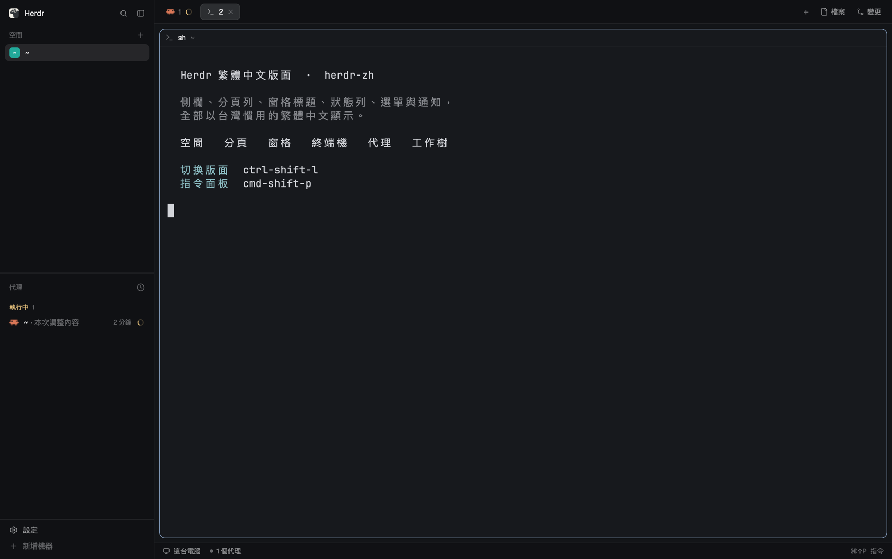

# Herdr 繁體中文版面（herdr-zh）

[Herdr](https://herdr.dev) 預設版面「Herdr」（`main`）的繁體中文（台灣用語）版。側欄、分頁列、窗格標題、狀態列、選單、對話框與通知都改用中文顯示，版面結構和操作方式與原版相同，只有收合側欄的方式不同（見「與原版的差異」）。



## 需求

- Herdr **0.1.17**：本版面從這個版本的內建版面複製而來，版本相差太多時，內建圖示或程式介面可能對不上。
- 已安裝 `herdr-app` 指令。macOS 版 Herdr 啟動時會自動建立 `~/.local/bin/herdr-app`。

## 安裝

### 方法一：交給 coding agent

在 Herdr 裡的 coding agent（例如 Claude Code、Codex）輸入：

> 請依照 ~/.config/herdr-app/AGENTS.md 的說明，安裝這個 Herdr 版面：https://github.com/leoho0722/herdr-app-zh-layout

Agent 會先讀過檔案、確認名稱沒有衝突，再複製並切換版面。

### 方法二：手動安裝（macOS／Linux）

```sh
git clone https://github.com/leoho0722/herdr-app-zh-layout.git
cd herdr-app-zh-layout

# 1. 確認沒有同名的版面或 mod（有輸出就代表名稱已被使用，請先處理）
ls ~/.config/herdr-app/layouts/herdr-zh.json 2>/dev/null
ls -d ~/.config/herdr-app/mods/*-zh 2>/dev/null

# 2. 複製版面與 14 個 mod
cp layouts/herdr-zh.json ~/.config/herdr-app/layouts/
cp -R mods/*-zh ~/.config/herdr-app/mods/

# 3. 切換到中文版面
herdr-app do layout.switch '{"name":"herdr-zh"}'
```

Herdr 會即時套用，不用重新啟動。

如果你的 Herdr 設定資料夾不在 `~/.config/herdr-app`（例如有設定 `HERDR_APP_HOME`，或在 Windows 上），請把 `layouts/herdr-zh.json` 和 `mods/` 底下的 14 個資料夾複製到該資料夾內的同樣位置。

### 確認安裝成功

```sh
# 每個 mod 都應顯示 check passed
for m in ~/.config/herdr-app/mods/*-zh; do herdr-app check "$m"; done

# layout 應為 herdr-zh，errors 應為 []
herdr-app status
```

`herdr-app check` 一次只跑一個比較快，同時跑多個會排隊。

## 切換與移除

- **切換版面：** 按 `ctrl-shift-l` 可以在 `herdr-zh`、`main` 等版面之間循環切換。也可以用指令切回英文原版：
  ```sh
  herdr-app do layout.switch '{"name":"main"}'
  ```
- **移除：** 先切回其他版面，再刪掉檔案：
  ```sh
  herdr-app do layout.switch '{"name":"main"}'
  rm ~/.config/herdr-app/layouts/herdr-zh.json
  rm -rf ~/.config/herdr-app/mods/{agents,changes,files,machine-add,menu,new-menu,pane,picker,spaces,tabs,toast,workspace-chrome,workspace-status,worktree}-zh
  ```
  如果有 `~/.config/herdr-app/layouts/.state/herdr-zh.json`（這個版面的側欄寬度等點擊紀錄），也可以一併刪除。

## 更新

```sh
cd herdr-app-zh-layout
git pull
cp layouts/herdr-zh.json ~/.config/herdr-app/layouts/
cp -R mods/*-zh ~/.config/herdr-app/mods/
```

複製後會覆蓋舊檔，Herdr 會即時重新載入。

## 包含哪些檔案

| 路徑 | 說明 |
|---|---|
| `layouts/herdr-zh.json` | 版面：側欄、分頁列、窗格、右側面板、狀態列 |
| `mods/spaces-zh`、`mods/agents-zh` | 側欄的「空間」「代理」清單 |
| `mods/workspace-chrome-zh` | 側欄頂部（搜尋、收合）與底部（設定、新增機器） |
| `mods/tabs-zh`、`mods/pane-zh` | 分頁列、窗格標題列 |
| `mods/files-zh`、`mods/changes-zh` | 右側「檔案」「變更」面板 |
| `mods/workspace-status-zh` | 底部狀態列 |
| `mods/menu-zh`、`mods/new-menu-zh` | 右鍵選單、「＋」新增選單 |
| `mods/picker-zh` | 快速切換（前往分頁、空間或代理） |
| `mods/worktree-zh`、`mods/machine-add-zh` | 工作樹、新增機器對話框 |
| `mods/toast-zh` | 通知 |

這些 mod 和 Herdr 內建的 mod 一樣，會執行以下程式，沒有額外的行為：
- `git`
- `hc`（herdr-core）
- `sh`／`powershell`
- `open`：在遠端 Mac 上開啟系統設定。

machine-add-zh 會讀取 `~/.ssh/config` 來列出主機。沒有任何 mod 自行連網。

## 與原版的差異

- **收合側欄會把整個側欄藏起來**：原版收合後會縮成 76px（macOS 以外為 44px）的圖示列，這裡改成和 `⌘B` 一樣把側欄整個隱藏。側欄隱藏時，分頁列最左側會出現「展開側欄」按鈕，點一下就恢復原本的寬度。
- 舊版收合後留下的圖示列，可以點代理清單底下的「»」展開。

## 已知限制

- **仍是英文的部分**：這些都不是由版面的 mod 繪製，因此無法翻譯。
  - Herdr 本身的畫面：設定、指令面板、歡迎頁、更新說明，以及 macOS 的選單列。
  - Herdr 直接開啟的確認、輸入、說明、預覽對話框。
  - Herdr 發出的其他錯誤通知。
  - git／hc 回傳的錯誤訊息。
- **不會跟著 Herdr 更新**：這些是內建版面的複本。Herdr 更新後，原版若有新功能或修正，這裡不會自動出現。
- **用語**：空間、分頁、窗格、終端機、代理、工作樹。完整對照見 [RECIPE.md](RECIPE.md)。

## 重新建置

[RECIPE.md](RECIPE.md) 記錄了這個版面的完整組成與建置方式。要從新版 Herdr 重新製作時，可以把它交給 coding agent 照著做。
