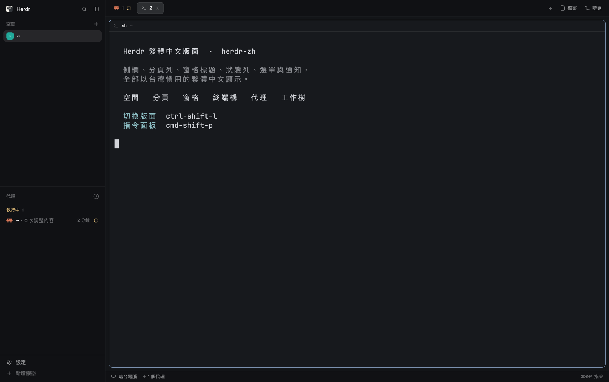

# Herdr 繁體中文（herdr-zh）

Herdr 預設版面「Herdr」（`main`）的繁體中文（台灣用語）版。版面結構和尺寸都和原版相同，行為只有收合側欄不同（整個隱藏，不縮成圖示列），其餘只是把側欄、分頁列、窗格標題、狀態列、選單、對話框和通知的介面文字改成中文：空間、分頁、窗格、終端機、代理、工作樹。沒有自己的主題或字型，外觀沿用使用者的 `settings.json`。



## 看到什麼（What you see）

由左到右：

- **左側欄** `sidebar`：寬 268px（可拖曳到 44–480px），背景 `chrome`。收合時整個隱藏，和 `⌘B`（`layout.toggle:sidebar`）相同，不像原版縮成 44px（macOS 為 76px）的圖示列。寬度小於 160px 時仍會畫成圖示列（原版收合留下的狀態），可用代理清單底部的「»」展開。
  - **頂部** `brand`（46px，可拖曳視窗）：
    - Herdr 圖示與名稱。
    - 放大鏡按鈕，提示文字「搜尋」，開啟快速切換。
    - 側欄按鈕，提示文字「收合側欄」，點擊後隱藏整個側欄；側欄是圖示列時（macOS 以外）改為「展開側欄」。
  - **「空間」清單**：依機器分組，標題為「這台電腦」或機器名稱。每個空間顯示名稱、分支、領先／落後與未提交變更，右上角「＋」新增空間。
    - 遠端機器顯示連線狀態：連線中、已連線、需要登入、無法連線、休眠中。
    - 遠端 Linux 機器在斷線後會停止代理時，標題旁出現「⚠」，提示「中斷連線後，這台機器上的代理會停止執行。點擊查看解決方法。」，點擊開啟新增機器對話框。
    - 切換空間時，清單會自動捲到目前的空間。
  - **「代理」清單**：
    - 依狀態分組：需要你、已完成、執行中、閒置，釘選的代理在最上方「已釘選」。
    - 每列右側顯示狀態持續時間，例如「<1 分鐘」「5 分鐘」「2 小時」「3 天」。
    - 右上角時鐘按鈕切換排序：「優先順序」或「依空間分組」。
    - 收合成圖示列時，目前所在的代理會反白。
  - 空間清單和代理清單上下各占一半，最小 90px。
  - **底部**（69px）：「設定」、「新增機器」。
- **右側工作區** `work`：
  - **分頁列**（42px，可拖曳視窗）：
    - 側欄隱藏時，最左側出現「展開側欄」按鈕（`mods/workspace-chrome/sidebar.svg`），點擊後顯示側欄。
    - 分頁膠囊：自己命名的分頁顯示該名稱；Herdr 命名的分頁顯示程式名稱，代理分頁則跟著代理的工作階段標題；都沒有時顯示「終端機」。
    - 在分頁列上捲動滾輪，一次切換一個分頁。
    - 「＋」新增選單。
    - 「檔案」「變更」面板按鈕。
  - **窗格區**：padding 8、gap 8，每個窗格是卡片：
    - 圓角 10、1px `border` 邊框，取得焦點時為 1px `accent` 邊框，背景 `background`。
    - 只有一個窗格時也套用卡片樣式（`lone: true`）。
    - 頂端 30px 標題列：程式圖示、名稱（窗格有自訂名稱時優先顯示）、資料夾、代理狀態。
  - **右側面板**：368px（280–900px），預設隱藏。堆疊「檔案」（檔案樹與預覽）和「變更」（git 變更、差異、提交）兩個面板，預覽與差異使用終端機的字型大小。
  - **狀態列**（28px，背景 `chrome`、上邊框，字級 11.8）：
    - 左側：「這台電腦」或機器名稱、分支、「N 個代理」，有代理在等你時加上「· N 個需要你」（`blocked` 色）。
    - 右側：「⌘⇧P 指令」，依實際綁定的按鍵顯示。
- 根節點：`titlebar: "none"`，macOS 紅綠燈位於 `[12, 16]`，背景 `canvas`，終端機 padding `[14, 12]`。

## 怎麼運作（How it behaves）

**代理狀態：**

| 狀態 | 窗格標題列 | 代理清單 | 通知 |
|---|---|---|---|
| working（執行中） | 每 900ms 旋轉一圈的 12px `spinner.svg`（`working` 色） | 「執行中」分組 | — |
| blocked（需要你） | 「需要你」徽章（`blocked` 色，背景為 `blocked` 加 `26` 透明度，圓角 5，高 18） | 「需要你」分組 | 「<名稱> 需要你」 |
| done（已完成） | 7px `done` 色圓點 | 「已完成」分組 | 「<名稱> 已完成」 |
| idle（閒置） | 無標示 | 「閒置」分組 | — |

**點擊與選單：**
- 滑鼠移到窗格標題列上時，會出現向右分割、向下分割、放大／還原、關閉四個按鈕；點擊標題列則讓窗格取得焦點。
- 終端機右鍵選單：重新命名、向右分割、向下分割、放大窗格、使用 Herdr 右鍵選單／將右鍵點擊傳給窗格、送回 <父代理>、關閉窗格。向右分割和向下分割各有自己的圖示。
- 分頁右鍵選單：重新命名、新增分頁、關閉。
- 空間右鍵選單：重新命名、新增工作樹、開啟工作樹、移除工作樹（僅工作樹空間）、關閉。
- 全域選單：新增空間、快速鍵、主題：graphite／ink／moss／atom one dark。
- 「＋」新增選單：
  - 終端機。
  - 啟動代理：列出已安裝的代理，沒裝的標「未安裝」，檢查中顯示「正在檢查已安裝的代理…」。
  - 新增空間、新增工作樹…、開啟工作樹…。

**對話框與快速切換：**
- 快速切換：輸入框提示「前往分頁、空間或代理…」，標題「前往…」。
  - 列出分頁與空間，並標示「需要你」「已完成」。
  - 較舊的空間收在「較早：N 個閒置空間 ▾」。
  - 底部可新增分頁或新增空間。
- 工作樹對話框：
  - 篩選工作樹、分支名稱、「主工作目錄」。
  - 新工作樹放在 settings.json 的 `worktrees.directory`（預設 `~/.herdr/worktrees`）；設定有誤時顯示「worktrees.directory 必須是絕對路徑，或以 ~/ 開頭。」等訊息。
  - 「N 分鐘前／小時前／天前／個月前」。
  - 移除前警告「有尚未提交的變更：這些變更將會遺失。」。
  - 移除前先檢查：主工作目錄不能移除，鎖定的工作樹顯示「這個工作樹已鎖定。」；在 macOS／Linux 上，git 拒絕移除時不會關閉空間。
  - 底部提示「↑↓ 選擇 · ↵ 開啟 · esc 關閉」。
- 新增機器對話框：
  - 「來自你的 ssh 設定」列出 `~/.ssh/config` 的主機，也可以「或輸入 ssh 連到它的方式」。
  - 按鈕狀態依序為「新增」→「連線中」→「已新增」。
  - 需要密碼或主機金鑰時，顯示要在終端機執行的 `hc machine add …`，並提供「複製」。
  - 已新增的機器另外列出，不會重複出現在 ssh 主機清單中。
  - 遠端 Linux 機器在斷線後會停止代理時，顯示「中斷連線後，<機器> 上的代理會停止執行」提示卡，附上要在該機器執行一次的 `sudo loginctl enable-linger -- <user>` 和「複製」按鈕。

**通知：**
- Herdr 送來的「X finished」「X needs you」標題改顯示為「X 已完成」「X 需要你」。
- 需要登入時顯示「<機器> 需要登入，請執行：」、`hc machine login <機器>` 和「複製」按鈕。
- 通知會顯示完整訊息，較長的錯誤也一樣，放不下時可以捲動。
- 點擊通知會執行它附帶的動作，例如跳到該代理。

`ctrl-shift-l` 可以在 herdr-zh 和其他版面之間切換。

## 組成（Built from）

**版面** `layouts/herdr-zh.json`：用 `herdr-app do layout.clone '{"name":"main","as":"herdr-zh"}'` 從 Herdr 0.1.17 的 `main` 複製（保留 `cloned_from`），再把下列區塊的 `content.mod` 換成中文版：

```
root (row)
├─ sidebar (column, 268px)
│  ├─ brand            → workspace-chrome-zh
│  ├─ sidebar-lists (column)
│  │  ├─ spaces        → spaces-zh
│  │  └─ agents        → agents-zh
│  └─ sidebar-footer   → workspace-chrome-zh  props: { footer: true }
└─ work (column)
   ├─ tabs             → tabs-zh
   ├─ work-body (row)
   │  ├─ main          { tab: "active", pane.header → pane-zh }
   │  └─ panel (hidden) → panel-body (stack): files → files-zh、changes → changes-zh
   └─ status           → workspace-status-zh
```

根節點另外設定 `"terminal_menu": "menu-zh"` 和 `"toast": "toast-zh"`。

**14 個 mod**：都用 `herdr-app do mod.clone '{"name":"<原名>","as":"<原名>-zh"}'` 從內建 mod 複製，再翻譯介面文字：

| mod | 用途 | 由誰開啟 |
|---|---|---|
| workspace-chrome-zh | 側欄頂部與底部 | 版面 |
| spaces-zh | 空間清單 | 版面 |
| agents-zh | 代理清單、排序選單 | 版面；排序選單由自己開啟 |
| tabs-zh | 分頁列 | 版面 |
| pane-zh | 窗格標題列 | 版面 `pane.header` |
| files-zh、changes-zh | 右側面板 | 版面 |
| workspace-status-zh | 狀態列 | 版面 |
| menu-zh | 右鍵選單 | `terminal_menu`、spaces-zh、tabs-zh |
| new-menu-zh | 「＋」新增選單 | tabs-zh |
| worktree-zh | 工作樹對話框 | menu-zh、new-menu-zh |
| picker-zh | 快速切換 | workspace-chrome-zh（`mod.open`） |
| machine-add-zh | 新增機器 | workspace-chrome-zh（`mod.open`）、spaces-zh（機器標題的「⚠」） |
| toast-zh | 通知 | 版面 `toast` |

**改了的跨 mod 參照**（`mod.clone` 不會自動改）：
- spaces-zh、tabs-zh 裡的 `mod: "menu"` 改成 `"menu-zh"`。
- spaces-zh 裡的 `mod: "machine-add"`（機器標題的「⚠」按鈕）改成 `"machine-add-zh"`。
- tabs-zh 裡的 `mod: "new-menu"` 改成 `"new-menu-zh"`。
- menu-zh、new-menu-zh 裡的 `mod: "worktree"` 改成 `"worktree-zh"`。
- workspace-chrome-zh 裡的 `mod.open` 的 `"picker"`、`"machine-add"` 改成 `"picker-zh"`、`"machine-add-zh"`。

**除了換字之外的程式改動：**
- workspace-chrome-zh：`button()` 多一個 `tip` 參數，搜尋鈕與側欄鈕加上 `.tooltip()`。
- workspace-chrome-zh：`toggleSidebar()` 在側欄不是圖示列時改用 `layout.hide` 隱藏整個側欄，不再縮成 76／44px；側欄已是圖示列（寬度小於 160px）時照舊展開回 `sidebar.width`。agents-zh 的 `toggleSidebar()` 只有圖示列的「»」會用到，維持原樣。
- tabs-zh：側欄隱藏（`sidebar.hidden`）時，在分頁捲動區前加上「展開側欄」按鈕，執行 `layout.show`。
- toast-zh：新增 `zhTitle()`，用 `/^(.+) finished$/`、`/^(.+) needs you$/` 把 Herdr 的通知標題轉成中文。
- spaces-zh：
  - 機器狀態用 `STATE_LABEL` 顯示（connecting 連線中、connected 已連線、needs_login 需要登入、unreachable 無法連線、asleep 休眠中），比較用的值不變。
  - `gitTail()` 的分支值 `(detached)`（以及備用值 `detached`）只在顯示時轉成「(分離 HEAD)」。
- worktree-zh：新增 `reason()`，顯示錯誤時去掉 `Error: ` 前綴。

**使用的內建資源**（不在本 repo，任何 Herdr 安裝都有）：
- `mods/workspace-chrome/*.svg`、`mods/pane/close.svg`、`mods/files/file.svg`、`mods/changes/changes.svg`
- `icons/shell.svg`、`frame/welcome/herdr.png`

**會執行的程式**（與內建 mod 相同，沒有額外行為）：
- `git`：spaces、menu、files、changes、worktree。
- `hc`：spaces、picker、machine-add。
- `sh`／`powershell`：files、worktree、machine-add。
- `open`：machine-add，在遠端 Mac 上開啟系統設定。

machine-add-zh 會讀 `~/.ssh/config`。沒有任何 mod 自行連網（`fetch`）。

**用語對照**：

| English | 中文 |
|---|---|
| Space / Tab / Pane / Terminal | 空間 / 分頁 / 窗格 / 終端機 |
| Agent / Sub-agent / Machine | 代理 / 子代理 / 機器 |
| Worktree / checkout | 工作樹 / 工作目錄 |
| Branch / Commit | 分支 / 提交 |
| working / blocked / done / idle | 執行中 / 需要你 / 已完成 / 閒置 |
| Pin / Unpin | 釘選 / 取消釘選 |
| Split right / Split down | 向右分割 / 向下分割 |
| Rename / Zoom | 重新命名 / 放大窗格 |
| Keybinds / commands | 快速鍵 / 指令 |

中文句子用全形標點；中文與英文、數字之間加半形空格。

## 注意事項（Watch out）

- **只翻顯示文字。** 這些字串程式會拿來比較，必須維持英文：
  - 狀態值（`"blocked"`、`"connected"`、`"needs_login"`、`"(detached)"`、`"adding"`、`"locked"`）。
  - 指令名稱與參數、`.id()`、`props`、`shared` 與 `localStorage` 的鍵。
  - `exec` 的參數，以及比對 git／hc 輸出的正規表示式（spaces-zh 的 `/^a different core answers there…/`、machine-add-zh 的 `/password|passphrase|host key|permission denied|login/i`、toast-zh 的 `needs login; run hc machine login` 比對）。
  - 同一個字串既要顯示又要比較時，保留英文鍵，另外加中文對照表。
- **內建 mod 是唯讀的。** Herdr 每次啟動都會覆蓋它們，直接改會被搬到 `<name>-edited`。一定要先 `mod.clone`／`layout.clone`。
- `mod.clone` 只會改 mod 自己的資源路徑和開啟自己的 overlay 名稱，**不會改指向其他 mod 的參照**，要手動改（見上方清單）。
- **翻不到的部分：**
  - Herdr 自己的畫面（`frame/` 的設定、指令面板、歡迎頁、更新說明）與 macOS 原生選單列。
  - Herdr 依名稱直接開啟的 `confirm`、`prompt`、`help`、`peek`。
  - Rust 端發出的其他錯誤通知。
  - git／hc 回傳的錯誤原文。
  - 這些都維持英文。
- **複本不會跟著 Herdr 更新。** 本版基於 0.1.17，版本相差太多時，內建資源路徑或 API 可能對不上，這時要依本 recipe 從新版重新複製並翻譯（見下方「升級到新版 Herdr」）。
- 分頁放大標記 `Z` 保留不翻：`max_w(170)` 放不下中文。
- 主題名稱 graphite、ink、moss、atom one dark 是專有名稱，保留英文。
- 中文多半比原文短，所有寫死的寬度都不用調整。
- 同時跑多個 `herdr-app check` 會排隊變很慢，請逐一執行。
- Herdr 視窗在背景時，`herdr-app shot` 會拿到舊畫面。

## 完成條件（Done when）

- 14 個 mod 都通過 `herdr-app check ~/.config/herdr-app/mods/<name>-zh`（exit 0）。
- 切到 `herdr-zh` 後，`herdr-app status` 的 `layout` 是 `herdr-zh`，`errors` 是 `[]`。
- 畫面上看得到：
  - 側欄：「空間」「代理」「設定」「新增機器」。
  - 分頁列：「檔案」「變更」。
  - 狀態列：「這台電腦」「N 個代理」「⌘⇧P 指令」。
- 按側欄頂部的收合鈕，側欄整個消失，分頁列最左側出現「展開側欄」；點它後側欄恢復原本的寬度。
- 有代理在跑時，代理清單出現「執行中」分組和「N 分鐘」。
- 代理等待輸入時，窗格標題出現「需要你」徽章，通知標題為「<名稱> 需要你」。
- 在終端機按右鍵，選單前兩項是「重新命名」「向右分割」。
- 「＋」新增選單出現「終端機」「啟動代理」「新增空間」。
- 在所有 `-zh` mod 的 `main.js` 裡 grep 英文字串，剩下的只有上方列出的刻意保留項。
- 按 `ctrl-shift-l` 切回 `main`，畫面恢復英文原版。

## 升級到新版 Herdr（Upgrading）

`herdr-zh` 和 `-zh` mod 已經存在時，`layout.clone`／`mod.clone` 會拒絕同名，所以從 0.1.15 升到 0.1.17 時是這樣做的：

1. 用 `mod.clone` 把 14 個內建 mod 複製成暫時的名稱（例如 `<原名>-zhbase`），讓 Herdr 自己改好資源路徑與自身 overlay 名稱。
2. 把暫時複本搬進 repo 的 `mods/<原名>-zh/`，同時把檔案裡的 `<原名>-zhbase` 換成 `<原名>-zh`，不要帶走 Herdr 產生的 `gpui-kit.d.ts`、`jsconfig.json`；接著從 `~/.config/herdr-app/mods/` 移除暫時複本。
3. 依上方「改了的跨 mod 參照」「除了換字之外的程式改動」和用語對照，重新套用翻譯。新版新增的英文字串要另外翻；舊版已有的譯文盡量沿用。
4. 版面：用 `jq -S` 比對新版 `layouts/main.json` 和 `herdr-zh.json`（去掉 `cloned_from`、`terminal_menu`、`toast`，並把 `-zh` 換回原名）。結構相同時只要把 `cloned_from.version` 改成新版本；不同時要依新版 `main` 重做。
5. 複製到 `~/.config/herdr-app/`，再照「完成條件」逐項檢查。
